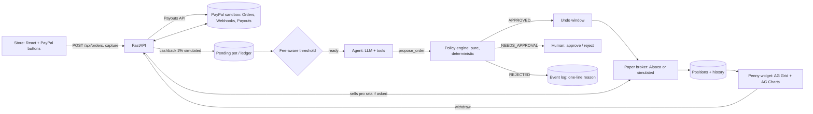

# Penny: shop, earn cashback, let an AI agent grow it

Penny is a web app where you buy products through a **real PayPal sandbox checkout** and earn **simulated** cashback. The small amounts pool in a "pending pot"; once a fee-aware threshold is reached, an AI agent invests the pot into a simple broad-index **paper** portfolio. A floating Penny widget (bottom-right) opens a live dashboard: cashback collected, what is invested, a value-vs-money-put-in chart, and a withdraw button that pays out through the PayPal sandbox.

> **Please read: this is a simulation.**
> * **Cashback is simulated.** Real cashback programs have no sandbox API, so Penny applies `CASHBACK_RATE` to sandbox payments. No real cashback provider is contacted.
> * **Trading is paper trading / a simulation** (Alpaca paper account, or the built-in simulated market). No real money, no real securities. Alpaca paper accounts do not simulate dividends, so P/L is price return only.
> * **Penny is not financial advice** and never promises returns.
> * **Seeded data is demo data.** With `SEED_ON_START=true` an empty database is filled with about 30 days of made-up history so the dashboard looks alive. It is not real activity.

## The core idea: the model proposes, rules decide

The LLM never executes anything. It calls tools; every order it proposes goes through `policy.validate()`, a pure, deterministic, unit-tested function. Explanations come from templates over ledger facts, and any sentence from the LLM that contains a number no tool returned is thrown away and replaced.



Everything money-related is `decimal.Decimal`, quantized to cents. Never float.

## Tools used

| Tool | How Penny uses it |
|---|---|
| **PayPal sandbox** | **Orders API v2** (create + capture the store checkout), **Webhooks** (signature-verified on the raw body; idempotent by capture/event id), **Payouts API** (withdrawals, including the `ERRPYO002` negative test) |
| **Groq** (OpenAI-compatible API) | The agent's LLM, via tool calling. 429s retry with exponential backoff; malformed tool calls are recovered or retried |
| **Alpaca paper trading** | Where orders are executed (`alpaca-py`); a simulated broker with the same interface is the fallback |
| **AG Grid + AG Charts (Community, MIT)** | Positions table, activity feed, and the performance chart in the dashboard |
| **Channel3** | Server-side product search for the "better deals" offers (`POST /v1/search`, `x-api-key`); labelled sample offers if no key |
| **Render** | Hosting via `render.yaml` (web service + free Postgres) |
| **Postman** | `postman/Penny.postman_collection.json`: the whole API in demo order |
| **APIMatic Context Plugin for PayPal** | <!-- REMOVE THIS ROW IF YOU DID NOT USE IT --> Used during development for PayPal API context |

## Repository layout

```
backend/    FastAPI app (app/), tests, scripts, requirements.txt, run.py
frontend/   React 18 + TypeScript + Vite (store page, Penny widget, dashboard)
postman/    API collection
render.yaml Render blueprint
.env.example, LICENSE (MIT)
```

## Setup (development)

Prerequisites: Python 3.11+, Node 18+.

```bash
# 1. backend
python -m venv .venv && source .venv/bin/activate
pip install -r backend/requirements.txt
cp .env.example .env                      # the ONE env file (repo root); edit it, see "Configuration"

# 2. frontend
cd frontend && npm install && cd ..

# 3. check your keys (reads only, never spends)
python backend/scripts/check_setup.py

# 4. run
cd backend && python run.py               # API on :8000
cd frontend && npm run dev                # app on http://localhost:5173 (proxies /api and /webhooks)
```

Single-process alternative: `cd frontend && npm run build`, then `cd backend && python run.py` and open http://localhost:8000.

**Webhooks (optional locally).** The web checkout credits cashback at capture time, so webhooks are not required to demo. To receive real ones: `ngrok http 8000`, add `https://<id>.ngrok.app/webhooks/paypal` in your PayPal sandbox app (events `PAYMENT.CAPTURE.COMPLETED`, `PAYMENT.PAYOUTS-ITEM.*`), and set `PAYPAL_WEBHOOK_ID` to the id PayPal shows. Keep `PAYPAL_WEBHOOK_ID=WEBHOOK_ID` for PayPal's simulator. A capture handled by both paths is credited **once** (both use the key `capture:<capture id>`).

## Setup (production on Render)

1. Push the repo to GitHub, then in the Render dashboard choose **New, Blueprint** and pick the repo. `render.yaml` creates the web service and a free Postgres (`DATABASE_URL` is wired automatically; `postgres://` URLs are normalised for SQLAlchemy).
2. Fill the `sync: false` secrets (PayPal, Alpaca, Groq, Channel3). `VITE_PAYPAL_CLIENT_ID` is read at **build** time (the sandbox client id is public by design).
3. Register `https://<your-app>.onrender.com/webhooks/paypal` as the PayPal webhook target and update `PAYPAL_WEBHOOK_ID`; redeploy.
4. Notes: free web services sleep after about 15 idle minutes (use a 10-minute uptime ping during judging); the free Postgres expires after 30 days (fine for a hackathon).
5. If the build fails with `npm: not found`, build the frontend locally (`cd frontend && npm ci && npm run build`), remove `dist/` from `.gitignore`, commit `frontend/dist`, and change the build command to `pip install -r backend/requirements.txt`.

## Demo script (about 3 minutes)

1. Open the app. Click **Find better deals** on a product (Channel3 offers, or labelled sample data).
2. Pay with the **PayPal sandbox buyer** (credentials go in your submission text, not in this repo). A toast says "Cashback credited: $X (simulated)" and Penny pops open.
3. Watch the pot and "Penny invests at $10.00, $Y to go". Buy again until the pot passes the threshold; the agent runs automatically (or `POST /api/agent/run`).
4. See the queued orders with **Undo** countdowns, then the executed trades, the one-line explanations, and the chart move.
5. **Withdraw**: tick "include my investments" to sell pro rata, press Withdraw, and watch "In transit to PayPal, then Completed". The payout lands in the sandbox personal account.

Postman: import `postman/Penny.postman_collection.json`, set `baseUrl`, and run top to bottom (it uses the simulated checkout, so it needs no PayPal login).

## Configuration

There is **one** env file: the repo-root `.env` (copy it from `.env.example`, which is the committed, secret-free template). The backend reads it, and Vite reads it too, but the browser only ever receives variables starting with `VITE_`, so secrets like `PAYPAL_CLIENT_SECRET` never reach the frontend bundle. Real environment variables win over the file.

| Variable | Meaning |
|---|---|
| `PAYPAL_ENV` | `sandbox` (the simulator id is only accepted in sandbox) |
| `PAYPAL_API_BASE` | PayPal REST base URL |
| `PAYPAL_CLIENT_ID` / `PAYPAL_CLIENT_SECRET` | Sandbox REST app credentials (the secret stays on the server) |
| `PAYPAL_WEBHOOK_ID` | Real webhook id, or the literal `WEBHOOK_ID` for the simulator |
| `PAYPAL_PAYOUT_RECEIVER_EMAIL` | Sandbox personal account that receives payouts |
| `PAYPAL_NEGATIVE_TEST` | `true` puts `ERRPYO002` in the payout note |
| `BROKER_MODE` | `alpaca` or `simulated`. Without real Alpaca keys Penny uses the simulator and logs a warning |
| `ALPACA_API_KEY_ID` / `ALPACA_SECRET_KEY` / `ALPACA_BASE_URL` | Alpaca **paper** credentials |
| `LLM_BASE_URL` / `LLM_API_KEY` / `LLM_MODEL` | OpenAI-compatible provider (default Groq). Model names change: `check_setup.py` lists the ones your key can use (for example `openai/gpt-oss-120b`) |
| `CHANNEL3_API_KEY` | Optional. Unset means sample deals |
| `RISK_PROFILE` | `conservative`, `balanced` or `growth` (changeable via `POST /api/profile`) |
| `CASHBACK_RATE` | Simulated cashback fraction (0.02 = 2%) |
| `FEE_ASSUMED_USD`, `MAX_FEE_DRAG_PCT`, `MIN_TRADE_USD` | Fee-aware threshold inputs |
| `TRADE_CAP_USD` | Orders above this need your approval |
| `HOLD_MAX_DAYS` | Invest anyway once cash has waited this long |
| `UNDO_WINDOW_SECONDS` | Delay before an approved order executes |
| `AGENT_INTERVAL_MINUTES` | Scheduler period for the agent |
| `QUOTE_STALENESS_SECONDS` | Max quote age the policy accepts (Alpaca quotes are stale outside US market hours) |
| `SEED_ON_START` | Seed demo history into an **empty** database |
| `AUTO_AGENT_ON_PURCHASE` | Optional (default `true`): run the agent right after a purchase if the pot is ready |
| `DATABASE_URL` | SQLite for dev, Postgres in production |
| `FRONTEND_ORIGIN` | CORS origin for the Vite dev server |
| `PORT`, `LOG_LEVEL` | App settings |
| `VITE_PAYPAL_CLIENT_ID` | Sandbox client id for the PayPal buttons (public by design; same value as `PAYPAL_CLIENT_ID`) |

## How decisions work

**Fee-aware threshold.** Invest when `pot >= max(MIN_TRADE_USD, FEE_ASSUMED_USD / MAX_FEE_DRAG_PCT)` (defaults: $10), or when the oldest cash has waited `HOLD_MAX_DAYS`. A $1.80 buy with a $0.50 fixed cost would lose about 28% to fees, so Penny pools. Alpaca is commission-free; the assumed cost stands in for money-movement fees. New cash goes to the most underweight fund; buys only.

**Policy engine** (`validate(proposal, profile, snapshot) -> APPROVED | NEEDS_APPROVAL | REJECTED(code)`):

| # | Rule | Outcome |
|---|---|---|
| 1 | Ticker on the profile allowlist (broad ETFs only: no stocks, leverage, options, crypto, shorts) | `TICKER_NOT_ALLOWED` |
| 2 | Allocation stays inside the profile band | `BAND_VIOLATION` |
| 3 | Order above `TRADE_CAP_USD` | `NEEDS_APPROVAL` |
| 4 | Order (and its plan) fits in the uncommitted pot | `INSUFFICIENT_POT` |
| 5 | Buys only; sells only for a user-initiated withdrawal | `SELL_NOT_ALLOWED` |
| 6 | Quote exists and is fresh | `QUOTE_MISSING` / `QUOTE_STALE` |

| Profile | Allowlist / target | "Equities" (VTI) band |
|---|---|---|
| conservative | VTI 30%, BND 70% | 20-40% |
| balanced | VTI 60%, BND 40% | 50-70% |
| growth | VTI 80%, VXUS 20% | 70-90% |

Orders from one plan are validated together (otherwise an empty portfolio could never place its first order inside a band). If market drift already pushed the portfolio out of band, a buy that moves it strictly closer to target is allowed.

**Agent safeguards.** If the model never proposes (or mistypes a ticker like `VXAT`), the deterministic planner proposes the missing planned orders through the same gate; the response says `"mode":"llm+planner"`. If the LLM is down, `"mode":"rule_based"` plus an `llm_error` says why.

**History.** `PortfolioSnapshot` is written on every executed trade, capture and payout, hourly by the scheduler, and `/api/history` appends a live point. `invested_cost` is the money you put in (cashback credited minus withdrawn), so `value - invested_cost` is true profit/loss even after sells.

## API reference

| Endpoint | Purpose |
|---|---|
| `GET /api/health` | Configured services, live broker, seed status |
| `GET /api/products`, `GET /api/products/{id}/image` | Store catalog (database-backed) |
| `GET /api/deals?product_id=` | Top 3 offers: Channel3, or `sample: true` |
| `POST /api/orders` `{product_id, mode?}` | Create a PayPal sandbox order at the server-side price |
| `POST /api/orders/{id}/capture` | Capture and credit simulated cashback (idempotent) |
| `POST /webhooks/paypal` | PayPal only: verify, dedupe, route (capture and payout events) |
| `GET /api/state` | Pot, holdings, totals, activity, approvals, latest payout |
| `GET /api/history?days=` | `[{t, value, invested_cost}]` for the chart |
| `GET /api/events`, `GET /api/explain` | Event log and last 50 one-line explanations |
| `POST /api/agent/run` | Run the agent once |
| `POST /api/proposals/{id}/approve`, `/reject`, `/undo` | Approval queue and undo window |
| `POST /api/withdraw` `{amount, include_investments}` | Sandbox payout (optionally sells pro rata first) |
| `POST /api/profile` | Change risk profile |

## Tests

```bash
cd backend && python -m pytest -q        # 133 tests, no network: in-memory SQLite + fake broker/PayPal/LLM/Channel3
cd frontend && npm run build             # type-checks (tsc --noEmit) then builds
```

## Troubleshooting

* **Nothing shows in my Alpaca dashboard.** Check `GET /api/health`: if `broker` is `simulated`, trades never reach Alpaca. Set `BROKER_MODE=alpaca` and real **paper** keys, view the *Paper* dashboard, and trade during US market hours (otherwise quotes are stale and the policy engine refuses).
* **`mode: rule_based` with an `llm_error`.** Read the message: wrong or unavailable `LLM_MODEL`, bad key, or a rate limit.
* **No demo history.** Seeding only runs on an empty database; delete the `.db` file (or use a new `DATABASE_URL`) and set `SEED_ON_START=true`.
* **PayPal buttons missing.** Set `VITE_PAYPAL_CLIENT_ID` in the root `.env` and rebuild (`npm run build`); without it the store offers a labelled simulated checkout.

## Submission checklist

* [ ] Public repo with the **MIT license** shown in the repo's About section
* [ ] Hosted demo URL (Render) and sandbox buyer credentials in the submission text (not in the repo)
* [ ] Demo video under 3 minutes: 0:00 problem (tiny cashbacks are ignored) · 0:20 deals + sandbox checkout · 1:00 cashback toast, pot and threshold · 1:30 agent run, undo window, explanations · 2:10 chart and holdings · 2:30 withdraw to PayPal · 2:50 tools and disclosures
* [ ] README tools table matches what you actually used (see the APIMatic row)
